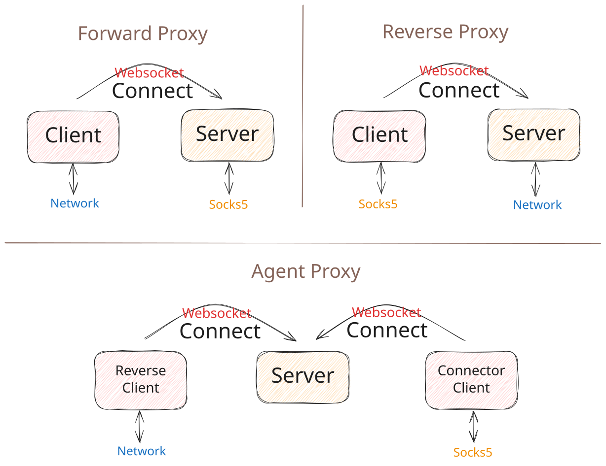

[](https://github.com/linksocks/linksocks/actions) [](https://app.codecov.io/gh/linksocks/linksocks/tree/main) [](https://hub.docker.com/r/jackzzs/linksocks)

# LinkSocks

LinkSocks 是一个基于 WebSocket 协议的跨网络跨机器 SOCKS 代理实现。

[English README / 英文文档](README.md)

## 概述

LinkSocks 允许您在 Web 应用防火墙（WAF）保护下安全地提供 SOCKS 代理服务（正向代理模式），或使没有公网 IP 的客户端连接并作为 SOCKS 代理服务器（反向代理模式）。

代理通道端到端加密（协议代 2）：provider 与 connector 协商 Noise XX 会话，目标地址、载荷和对端裁决都在密文内，中继只按 channel ID 转发帧；Zone 数据包在成员之间加密；网站发布沿用旧协议代，因为中继需要读取 HTTP 才能提供服务域名。



📖 **文档**: https://linksocks-docs.zetx.tech/

**网站**：[l.zetx.tech](https://l.zetx.tech) ·
[公开 Zone](https://l.zetx.tech/zones)

## 特性

1. 代理通道端到端加密（协议代 2）：provider 与 connector 运行 Noise XX 握手，目标地址与载荷都在密文内，中继只按 channel ID 转发
2. 支持命令行使用、API 服务器和库集成
3. 支持正向、反向和中继代理模式
4. 反向代理支持轮询负载均衡
5. 混合本地代理端口：同一端口同时支持 SOCKS5 与 HTTP 代理
6. 本地代理身份验证（SOCKS5 用户名密码与 HTTP Basic）
7. 支持 SOCKS5 上的 IPv6
8. 支持 SOCKS5 上的 UDP
9. Zone 虚拟 IPv4 网络：默认在本机运行 SOCKS5 代理，Linux 下可用 `--vlan` 创建二层 TAP 网卡

## 潜在应用场景

1. 分布式 HTTP 后端
2. 使用客户端代理绕过验证码
3. 通过 CDN 网络实现安全的内网穿透

作为一个好的案例, 请参考 [LinkTerm](https://github.com/linksocks/linkterm) 和 [Cloudflyer](https://github.com/cloudflyer-project/cloudflyer) 项目.

## 快速开始

### 正向代理

```bash
# 服务端：在 8765 端口启动 WebSocket 服务
linksocks server -t example_token

# 客户端：连接到服务端并在 9870 端口提供 SOCKS5 代理
linksocks client -t example_token -u ws://localhost:8765 -p 9870

# 测试代理
curl --socks5 127.0.0.1:9870 http://httpbin.org/ip
```

同一本地端口也接受 HTTP 代理客户端：

```bash
curl -x http://127.0.0.1:9870 http://httpbin.org/ip
curl -x http://127.0.0.1:9870 https://httpbin.org/ip
```

### 反向代理

```bash
# 服务端：在 9870 端口启动 SOCKS5 代理服务
linksocks server -t example_token -r -p 9870

# 客户端：作为网络提供方连接
linksocks client -t example_token -u ws://localhost:8765 -r

# 测试代理
curl --socks5 127.0.0.1:9870 http://httpbin.org/ip
```

### 中继代理

```bash
# 服务端：使用提供方和连接器令牌启动服务
linksocks server -t provider_token -c connector_token -p 9870 -r

# 提供方：作为网络提供方连接
linksocks provider -t provider_token -u ws://localhost:8765

# 连接器：连接并使用代理
linksocks connector -t connector_token -u ws://localhost:8765 -p 1180

# 测试代理
curl --socks5 127.0.0.1:1180 http://httpbin.org/ip
```

### 中继代理（自助连接者管理）

```bash
# 服务端：以自助连接者管理方式启动中继
linksocks server -t provider_token -r -a

# 提供方：provider 设置自己的 connector token
linksocks provider -t provider_token -c my_connector_token -u ws://localhost:8765

# 连接器：使用 provider 登记的 connector token 访问该 provider
linksocks connector -t my_connector_token -u ws://localhost:8765 -p 1180
```

### 网站反向代理

`linksocks web` 可以把本地 HTTP(S) 网站发布到
[linksocks.js](https://github.com/linksocks/linksocks.js) Worker。HTTP 请求复用同一条
WebSocket 隧道，源站始终位于 NAT 之后，无需公网 IP 或入站端口。

```bash
# 匿名临时域名（服务端 WEB_ZONE=example.com）
linksocks web -u wss://linksocks.example.com -l http://127.0.0.1:8080

# 使用账号令牌发布固定域名，并配置两个本地源站
linksocks web -u wss://linksocks.example.com -t ls_xxx \
  --domain blog.example.com \
  -l http://127.0.0.1:8080 -l http://127.0.0.1:8081
```

参数概览：`-t/--token`、`-u/--url`、`-l/--local`（可重复）、`--domain`、
`--insecure`（跳过 https 源站证书校验）、`-R/--no-reconnect`、`-d/--debug`。

`--domain` 使用的是账号的**永久域名授权**，需要在 linksocks.js 管理后台为对应账号
开启。授权后该域名不轮换也不过期，Provider 在场就一直有效；没有授权的账号请求
`--domain` 会被服务端拒绝。服务端开启强制临时域名（`forceTemporaryHost`）时，
未获授权的账号即使指定 `--domain` 也会被改写成随机域名，日志里会给出新 URL。

#### 实测示例

先在本地起一个网页服务，再通过公共中继发布，最后从公网访问：

```bash
$ python3 -m http.server 8080 --bind 127.0.0.1

$ linksocks web -u wss://l.zetx.tech -l http://127.0.0.1:8080
2026-11-02T16:41:25+08:00 INF Starting LinkSocks web provider backends=["http://127.0.0.1:8080"] domain= insecure=false server=wss://l.zetx.tech
2026-11-02T16:41:28+08:00 INF Welcome to LinkSocks.js relay server. This server is running in edge: AMS (Amsterdam, Netherlands), relay: KIX (Osaka, Japan). Your connection comes from CN (<client-ip>). After you connected, this relay group has 1 provider and 0 connectors.
2026-11-02T16:41:29+08:00 INF Web site published backends=1 expires=2026-11-02T22:41:28+08:00 host=ugxzfihx.team1.cc.cd temporary=true url=https://ugxzfihx.team1.cc.cd
2026-11-02T16:41:29+08:00 INF Temporary URL https://ugxzfihx.team1.cc.cd expires at 2026-11-02T22:41:28+08:00; it will rotate automatically
```

中继分配了 `https://ugxzfihx.team1.cc.cd`，访问该地址的请求会转发到本地源站：

```bash
$ curl -sS https://ugxzfihx.team1.cc.cd/
<!doctype html>
<html><head><title>LinkSocks demo site</title></head>
<body><h1>Hello from a local origin</h1><p id="marker">linksocks-web-demo-20261102</p><script src="/assets/app.js"></script></body></html>

$ curl -sS -o /dev/null -w '%{http_code}\n' https://ugxzfihx.team1.cc.cd/assets/app.js
200

$ curl -sS -o /dev/null -w '%{http_code}\n' https://ugxzfihx.team1.cc.cd/not-found
404
```

终端保持运行时隧道一直有效，`Ctrl+C` 结束。临时域名按服务端配置的临时网址有效期
过期（默认 6 小时），Provider 在线期间域名会自动轮换。

服务端（Cloudflare Worker、D1 数据库、管理后台与配额）说明见 linksocks.js 仓库。

### Zone 虚拟网络

Zone 是一组机器共享的虚拟 IPv4 网络。打开 linksocks.js 网站的 `/zones` 页面，
即可查看成员并复制加入命令。加入无需账号；登录用户可以创建 Zone、删除自己的
Zone，管理员可以管理全部 Zone。新建 Zone 默认为私有，只有拿到 Zone ID 的机器
才能加入。公开 Zone 仅管理员可以创建，会出现在网站的 **Public zones** 视图和
`linksocks zone list` 中。

默认加入不需要特殊权限：`linksocks zone join <id>` 会在本机 `127.0.0.1:1080`
启动 SOCKS5 代理，通过虚拟 IP 或成员名访问成员的 TCP 和 UDP 服务。Linux 下可用
`--vlan`（需要 root）创建二层 TAP 网卡，支持 ARP、ICMP、广播、组播和 WOL。

每台机器保留本地 Ed25519 身份。异常掉线后虚拟地址保留 24 小时，Ctrl+C 或
`zone leave` 则立即释放。流量经 Worker 中继端到端加密传输。Zone 所有者和
管理员可以设置欢迎语和防火墙规则（最多 64 条有序规则，含默认策略），并踢出
或移除成员。

平台要求、身份密钥、多网卡和真实 Linux 实测见
[Zone 使用指南](https://linksocks.github.io/zh/guide/zones)。Zone 没有 Python 库 API。

自行部署需要 Worker 的 `DB` 绑定、指向 SQLite 存储 `Zone` Durable Object 的
`ZONE` 绑定，以及 D1 迁移 `0005_zones.sql` 与 `0006_zone_visibility.sql`。详见
[Worker 部署说明](https://github.com/linksocks/linksocks.js/blob/main/README.cn.md#zone-虚拟网络)。

## 安装

### Golang 版本
```bash
go install github.com/linksocks/linksocks/cmd/linksocks@latest
```

或从[发布页面](https://github.com/linksocks/linksocks/releases)下载预编译二进制文件。

### Docker
```bash
docker run --rm -it jackzzs/linksocks --help
```

### Python 版本
```bash
pip install linksocks
```

> Python 版本是 Golang 实现的封装。详见：[Python 绑定](https://linksocks-docs.zetx.tech/python/)

## Cloudflare Worker

LinkSocks 服务端可以部署在 Cloudflare Worker 上，详见：[linksocks/linksocks.js](https://github.com/linksocks/linksocks.js)

[](https://deploy.workers.cloudflare.com/?url=https://github.com/linksocks/linksocks.js)

Worker 提供账号、网站发布和 Zone 管理页面，其管理接口与下文 Go 服务端的令牌 API 不同。

## API 服务

## API 服务端

LinkSocks 服务端提供用于动态令牌管理的 HTTP API：

```bash
# 启用 API 功能启动服务端
linksocks server --api-key your_api_key
```

API Key 仅用于认证，不携带任何访问规则。访问控制通过令牌级别（建令牌时指定）或服务器级别（entry/dial access control）配置。

详细的 API 使用说明和示例，请参见：[HTTP API](https://linksocks-docs.zetx.tech/guide/http-api)

## 许可证

LinkSocks 在 MIT 许可证下开源。
