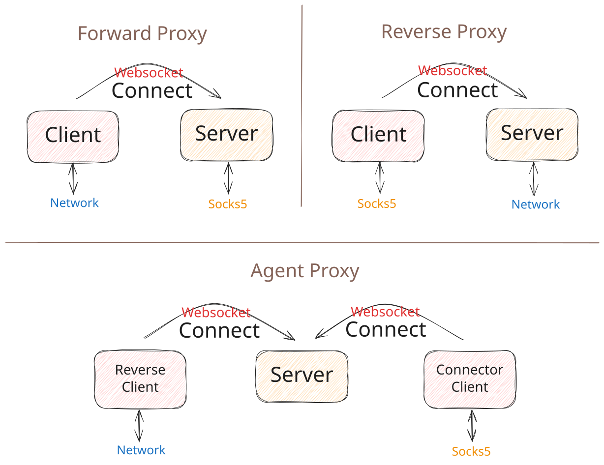

[](https://github.com/linksocks/linksocks) [](https://github.com/linksocks/linksocks/actions) [](https://app.codecov.io/gh/linksocks/linksocks/tree/main)  [](https://pypi.org/project/linksocks/)  

# LinkSocks

LinkSocks is a SOCKS proxy implementation over WebSocket protocol.

[中文文档 / Chinese README](README.cn.md)

## Overview

LinkSocks is a secure SOCKS5 proxy over WebSocket. It allows you to traverse firewalls and complex network topologies by tunneling traffic through standard web connections.

Its architecture allows you to hide the proxy server behind a WAF or CDN (like Cloudflare). By disguising proxy traffic as normal HTTPS requests, it protects the server's real IP address and evades deep packet inspection.

Crucially, it supports Serverless Intranet Penetration (compatible with Cloudflare Workers). This allows you to bridge two private networks securely without a dedicated VPS. Since both the user and the internal resource actively connect to the serverless cloud relay, you can access your home or office network without a public IP or opening any risky inbound ports.

Proxy channels are end-to-end encrypted (protocol generation 2): the provider and connector negotiate a Noise XX session, so destination addresses, payloads and peer decisions stay inside the ciphertext, and the relay only forwards frames by channel ID. Zone packets are encrypted between members as well. Site publishing runs on the legacy protocol because the relay reads HTTP to serve the hostname.



📖 **Documentation**: [https://linksocks.github.io](https://linksocks.github.io)

**Website**: [l.zetx.tech](https://l.zetx.tech) ·
[Public zones](https://l.zetx.tech/zones)

## Features

1. End-to-end encrypted proxy channels (protocol generation 2): a Noise XX handshake between provider and connector keeps destinations and payloads inside the ciphertext, and the relay only routes frames by channel ID.
2. Forward, reverse and relay proxy modes.
3. Round-robin load balancing for reverse proxy.
4. Hybrid local proxy port: SOCKS5 and HTTP proxy on the same port.
5. Local proxy authentication (SOCKS5 username/password and HTTP Basic).
6. IPv6 & UDP over SOCKS5 support.
7. Robust code driven by comprehensive tests.
8. Command-line usage, API server, and library integration.
9. Serverless relay server supported by Cloudflare Worker.
10. Zone networks with virtual IPv4 addresses: a local SOCKS5 proxy by default, or an L2 TAP interface on Linux with `--vlan`.

## Potential Applications

1. Distributed HTTP backend.
2. Bypassing CAPTCHA using client-side proxies.
3. Secure intranet penetration, using CDN network.

As great examples, see these projects: [LinkTerm](https://github.com/linksocks/linkterm) and [Cloudflyer](https://github.com/cloudflyer-project/cloudflyer).

## Quick Start

### Forward Proxy

```bash
# Server Side: Start server with WebSocket on port 8765
linksocks server -t example_token

# Client Side: Connect to server and provide SOCKS5 proxy on port 9870
linksocks client -t example_token -u ws://localhost:8765 -p 9870

# Test the proxy
curl --socks5 127.0.0.1:9870 http://httpbin.org/ip
```

The same local port also accepts HTTP proxy clients:

```bash
curl -x http://127.0.0.1:9870 http://httpbin.org/ip
curl -x http://127.0.0.1:9870 https://httpbin.org/ip
```

### Reverse Proxy

```bash
# Server Side: Start server with SOCKS5 proxy on port 9870
linksocks server -t example_token -r -p 9870

# Client Side: Connect as network provider
linksocks client -t example_token -u ws://localhost:8765 -r

# Test the proxy
curl --socks5 127.0.0.1:9870 http://httpbin.org/ip
```

### Relay Proxy

```bash
# Server Side: Start server with both provider and connector tokens
linksocks server -t provider_token -c connector_token -p 9870 -r

# Provider Side: Connect as network provider
linksocks provider -t provider_token -u ws://localhost:8765

# Connector Side: Connect to use the proxy
linksocks connector -t connector_token -u ws://localhost:8765 -p 1180

# Test the proxy
curl --socks5 127.0.0.1:1180 http://httpbin.org/ip
```

### Relay Proxy (Self-Managed Connectors)

```bash
# Server Side: Start server with self-managed connectors
linksocks server -t provider_token -r -a

# Provider Side: Provider registers its own connector token
linksocks provider -t provider_token -c my_connector_token -u ws://localhost:8765

# Connector Side: Use the provider-registered connector token to reach this provider
linksocks connector -t my_connector_token -u ws://localhost:8765 -p 1180
```

You can also use our public server (for self-managed connector relay) at `ws://l.zetx.tech`:

```bash
# Provider Side: Provider registers its own connector token
linksocks provider -c my_connector_token -u l.zetx.tech

# Connector Side: Use the provider-registered connector token to reach this provider
linksocks connector -t my_connector_token -u l.zetx.tech -p 1180
```

If you are using the public server, please use a complex token, as anyone holding the token can connect to your service.

Use the following linux command to generate a complex token:

```bash
openssl rand -hex 16
```

### Web Reverse Proxy

`linksocks web` publishes a local HTTP(S) website through a
[linksocks.js](https://github.com/linksocks/linksocks.js) Worker. Incoming HTTP
requests travel over the same WebSocket tunnel, so the origin stays behind NAT
with no inbound ports.

```bash
# Anonymous temporary host on a linksocks.js deployment with WEB_ZONE=example.com
linksocks web -u wss://linksocks.example.com -l http://127.0.0.1:8080

# Account token, custom host and two origins for local load balancing
linksocks web -u wss://linksocks.example.com -t ls_xxx \
  --domain blog.example.com \
  -l http://127.0.0.1:8080 -l http://127.0.0.1:8081
```

Flag summary: `-t/--token`, `-u/--url`, `-l/--local` (repeatable),
`--domain`, `--insecure` (skip TLS verification for https origins),
`-R/--no-reconnect`, `-d/--debug`.

`--domain` spends the account's **permanent hostname grant**, which an
administrator enables per account in the linksocks.js console. A granted host
never rotates and never expires, so it stays up as long as its provider does;
the relay refuses `--domain` from an account without the grant. When the
deployment turns on forced temporary hostnames (`forceTemporaryHost`), an
ungranted account is rewritten to a generated host and the log line reports the
new URL.

#### A real run

Serve a local site, publish it through the public relay, and fetch it from the
internet:

```bash
$ python3 -m http.server 8080 --bind 127.0.0.1

$ linksocks web -u wss://l.zetx.tech -l http://127.0.0.1:8080
2026-11-02T16:41:25+08:00 INF Starting LinkSocks web provider backends=["http://127.0.0.1:8080"] domain= insecure=false server=wss://l.zetx.tech
2026-11-02T16:41:28+08:00 INF Welcome to LinkSocks.js relay server. This server is running in edge: AMS (Amsterdam, Netherlands), relay: KIX (Osaka, Japan). Your connection comes from CN (<client-ip>). After you connected, this relay group has 1 provider and 0 connectors.
2026-11-02T16:41:29+08:00 INF Web site published backends=1 expires=2026-11-02T22:41:28+08:00 host=ugxzfihx.team1.cc.cd temporary=true url=https://ugxzfihx.team1.cc.cd
2026-11-02T16:41:29+08:00 INF Temporary URL https://ugxzfihx.team1.cc.cd expires at 2026-11-02T22:41:28+08:00; it will rotate automatically
```

The relay assigned `https://ugxzfihx.team1.cc.cd`, and requests to it reach the
local origin:

```bash
$ curl -sS https://ugxzfihx.team1.cc.cd/
<!doctype html>
<html><head><title>LinkSocks demo site</title></head>
<body><h1>Hello from a local origin</h1><p id="marker">linksocks-web-demo-20261102</p><script src="/assets/app.js"></script></body></html>

$ curl -sS -o /dev/null -w '%{http_code}\n' https://ugxzfihx.team1.cc.cd/assets/app.js
200

$ curl -sS -o /dev/null -w '%{http_code}\n' https://ugxzfihx.team1.cc.cd/not-found
404
```

The tunnel stays open until `Ctrl+C`. The temporary hostname expires after the
deployment's temporary URL lifetime (6 hours by default) and rotates
automatically while the provider stays connected.

The server side (Cloudflare Worker, D1 database, admin console and quotas) is
documented in the linksocks.js repository.

### Zone Networks

A zone is a virtual IPv4 network shared by a group of machines. Browse
`/zones` on a linksocks.js website to view members and copy a join command. No
account is needed to join; signed-in users create zones and delete their own,
and administrators manage all zones. New zones are private, and only machines
given the zone ID can join. Only administrators can create public zones; those
appear in the website's Public zones view and in `linksocks zone list`.

Joining needs no privileges by default: `linksocks zone join <id>` starts a
local SOCKS5 proxy on `127.0.0.1:1080` that reaches members by virtual IP or
name over TCP and UDP. On Linux, `--vlan` (root) creates an L2 TAP interface
with ARP, ICMP, broadcast, multicast and Wake-on-LAN support.

Each machine keeps a local Ed25519 identity. An abrupt disconnect retains its
virtual address for 24 hours, while Ctrl+C or `zone leave` releases it
immediately. Traffic is end-to-end encrypted through the Worker relay. Zone
owners and administrators can set a welcome message and firewall rules (up to
64 ordered rules with a default policy) and kick or remove members.

See the [zone guide](https://linksocks.github.io/guide/zones) for details and a
verified Linux run. There is no Python library API for zones.

Self-hosted coordinators need the Worker `DB` binding, the `ZONE` binding to
the SQLite-backed `Zone` Durable Object, and the D1 migrations
`0005_zones.sql` and `0006_zone_visibility.sql`. See
[Worker deployment](https://github.com/linksocks/linksocks.js#zone-networks).

## Installation

### Golang Version
```bash
go install github.com/linksocks/linksocks/cmd/linksocks@latest
```

Or download pre-built binaries from [releases page](https://github.com/linksocks/linksocks/releases).

### Docker
```bash
docker run --rm -it jackzzs/linksocks --help
```

### Python Version
```bash
pip install linksocks
```

> The python version is a wrapper of the Golang implementation. See: [Python Bindings](https://linksocks.github.io/python).
>
> A pure python version with basic support is also available . See [Pywssocks](https://github.com/linksocks/pywssocks).

## Cloudflare Worker

LinkSocks server (for self-managed connector relay) can be hosted on Cloudflare Worker, see: [linksocks/linksocks.js](https://github.com/linksocks/linksocks.js)

[](https://deploy.workers.cloudflare.com/?url=https://github.com/linksocks/linksocks.js)

The Worker includes a website for accounts, web publishing and zones. Its
management endpoints are separate from the Go server's token API below.

## API Server

LinkSocks server provides an HTTP API for dynamic token management:

```bash
# Start server with API enabled
linksocks server --api-key your_api_key
```

API keys authenticate only and never carry access rules. Access control is
attached per token (via the token creation API) or at the server level
(entry/dial access control).

For detailed API usage and examples, see: [HTTP API](https://linksocks.github.io/guide/http-api)

## License

LinkSocks is open source under the MIT license.
